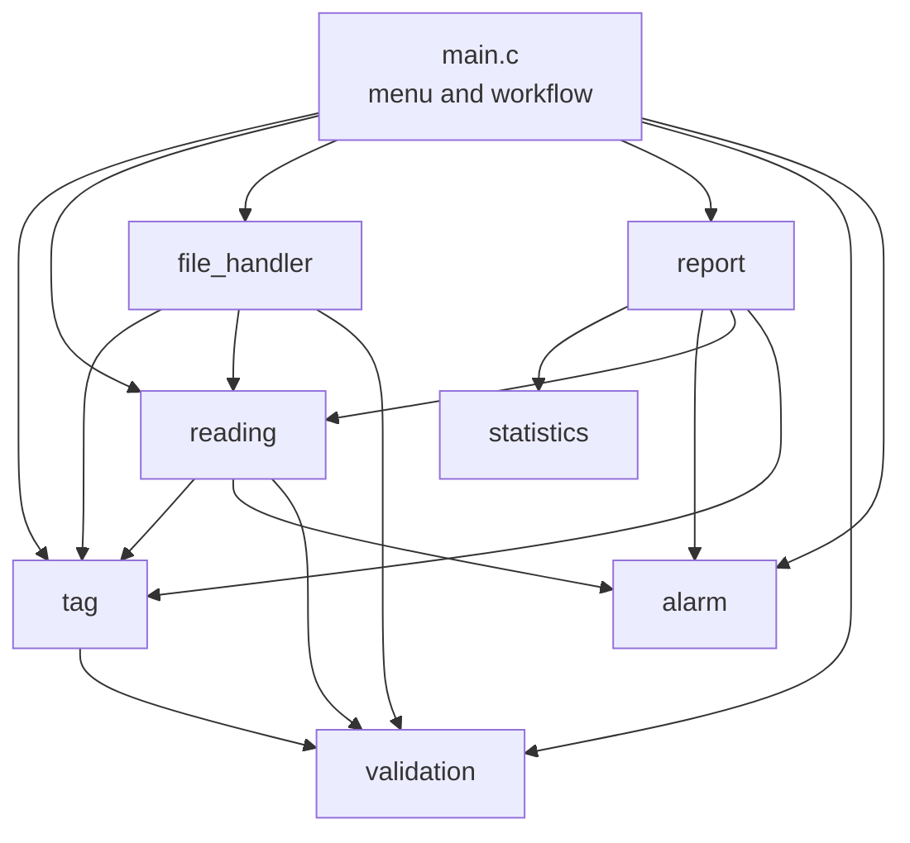

# Process Data Logger and Alarm Analyzer

A modular, menu-driven C application that records process readings from industrial instruments, classifies them against alarm limits, and produces statistics and shift reports. It is built with a Makefile and tested with Google Test.

**Engineering domain:** Manufacturing (industrial process instrumentation)
**GitHub repository:** https://github.com/Dhruv171007/process-data-logger-alarm-analyzer

---

## Problem Statement

In industrial process plants, operators and instrumentation engineers currently face difficulty in reviewing large sets of logged process readings against alarm limits. The current method results in missed alarm events, calculation errors and slow shift reporting. This software provides tag management, validated reading entry and import, alarm classification, statistical analysis and automatic report generation, so that users can quickly identify abnormal process behaviour and produce accurate shift reports.

## Proposed Solution

The application manages **tags** (measurement points such as `TT-101`, each with a description, a unit and four alarm limits) and **readings** (a timestamped value for a tag). It validates all input, classifies every reading as Normal, Low, Low-Low, High or High-High, calculates statistics and time spent in alarm, and writes a shift report to a text file. Data is saved to files and reloaded at the next start.

## Features

- Add, edit, delete, search and list tags with four alarm limits (Low-Low, Low, High, High-High)
- Add readings manually with full validation (tag, timestamp, value)
- Import readings from a CSV file; invalid lines are skipped and counted
- Classify readings into alarm states (limits are inclusive)
- Filter readings by tag, alarm status and time range; sort by value or timestamp
- Statistics per tag: minimum, maximum, mean and (population) standard deviation
- Time spent in alarm per tag
- Shift report saved as a text file
- Save and load tags and readings from files
- Safe input handling: invalid input never crashes the program

---

## Architecture

`main.c` only controls the menu and the workflow. Every other module has one responsibility. All modules use the shared types and constants in `common.h`. Arrows show "uses".



## Modules

| Module | Files | Responsibility |
|--------|-------|----------------|
| Main | `src/main.c` | Menu display and high-level workflow control; owns all data arrays |
| Common | `include/common.h` | Constants, structures (`Tag_t`, `Reading_t`, `ReadingFilter_t`) and enumerations (`Status_t`, `AlarmStatus_t`, `SortField_t`, `SortOrder_t`) |
| Validation | `validation.c/.h` | Validate tag IDs, timestamps, alarm limits, descriptions, units and menu choices; parse numbers safely; read lines safely |
| Statistics | `statistics.c/.h` | Minimum, maximum, mean and standard deviation |
| Alarm | `alarm.c/.h` | Classify a reading against tag limits; calculate time in alarm |
| Tag | `tag.c/.h` | Add, find, edit and delete tags |
| Reading | `reading.c/.h` | Add and delete readings; filter, sort and extract values |
| File handler | `file_handler.c/.h` | Save and load tags and readings; CSV import |
| Report | `report.c/.h` | Screen tables, alarm summary, shift report file, status and alarm texts |

## Folder Structure

```
process-data-logger-alarm-analyzer/
|-- src/
|   |-- main.c
|   |-- alarm.c
|   |-- file_handler.c
|   |-- reading.c
|   |-- report.c
|   |-- statistics.c
|   |-- tag.c
|   `-- validation.c
|-- include/
|   |-- common.h
|   |-- alarm.h
|   |-- file_handler.h
|   |-- reading.h
|   |-- report.h
|   |-- statistics.h
|   |-- tag.h
|   `-- validation.h
|-- tests/
|   |-- test_alarm.cpp
|   |-- test_file_handler.cpp
|   |-- test_reading.cpp
|   |-- test_report.cpp
|   |-- test_statistics.cpp
|   |-- test_tag.cpp
|   `-- test_validation.cpp
|-- data/
|   |-- sample_tags.txt
|   |-- sample_readings.csv
|   `-- sample_readings_invalid.csv
|-- docs/
|   |-- project_proposal.md
|   `-- detailed_design.md
|-- Makefile
|-- README.md
|-- .gitignore
`-- LICENSE
```

## C Concepts Used

| Concept | Where it is used |
|---------|------------------|
| Functions and multi-file modules | Every module has its own `.c` and `.h` file with header guards |
| Structures | `Tag_t`, `Reading_t` and `ReadingFilter_t` group related data |
| Enumerations | Alarm states, sort options and the `Status_t` return codes |
| Arrays | Fixed-size arrays of tags and readings, owned by `main()` |
| Strings | Tag IDs, descriptions, units and timestamps (`strcmp`, `strlen`, `strcpy` after validation) |
| Pointers | Arrays and structures passed to functions; results returned through output parameters |
| `#define` constants | Capacities, sizes, valid ranges, the sampling interval and file paths |
| File handling | `fopen`, `fgets`, `fprintf`, `fclose` with every result checked |
| Standard library | `strtod` for safe number parsing, `memmove` for deleting records, `math.h` for `sqrt` |
| `static` functions | Private helpers inside a module (for example `isLeapYear` in `validation.c`) |

## Coding Standards

| Item | Convention | Example |
|------|-----------|---------|
| Source and header files | lowercase with underscores | `file_handler.c`, `file_handler.h` |
| Functions | camelCase, verb first | `calculateMean`, `addReading` |
| Local variables and members | snake_case | `tag_count`, `high_high` |
| Structures and enumerations | PascalCase with `_t` suffix | `Tag_t`, `Status_t` |
| Constants and enum values | UPPER_SNAKE_CASE | `MAX_READINGS`, `STATUS_NOT_FOUND` |

- Indentation: 4 spaces, no tabs in C code. Brace style: each brace on its own line. Line length: about 100 characters.
- Compiler flags: `-Wall -Wextra -Wpedantic -std=c11` (C) and `-std=c++17` (tests). The code builds without warnings.
- Every function returns a `Status_t` (or a plain value for simple text helpers), checks pointer arguments for NULL, and returns results through output parameters that are written only on success.
- No global variables. Private helper functions are `static`. Constants are named instead of repeated numbers for sizes, limits and paths.
- Avoided: `gets` and `scanf` (input uses `fgets`), unchecked file operations, and copying text into a fixed buffer before its length has been validated.

---

## Prerequisites

- A C compiler and a C++ compiler (GCC and G++)
- GNU Make
- Google Test

**Windows (MSYS2).** Install MSYS2 from https://www.msys2.org, open the **MSYS2 UCRT64** terminal and run:

```
pacman -Syu
pacman -S --needed base-devel mingw-w64-ucrt-x86_64-toolchain mingw-w64-ucrt-x86_64-gtest
```

**Linux (Ubuntu or Debian):**

```
sudo apt install build-essential libgtest-dev
```

## Build, Run and Test

Run all commands from the project root (the data file paths are relative).

| Command | What it does |
|---------|--------------|
| `make all` | Builds the application to `build/analyzer.exe` |
| `make run` | Builds and runs the application |
| `make test` | Builds and runs all unit tests |
| `make clean` | Removes the `build/` folder |

The executables use the `.exe` name on every platform to keep the Makefile simple.

### Quick start

```
git clone https://github.com/Dhruv171007/process-data-logger-alarm-analyzer.git
cd process-data-logger-alarm-analyzer
cp data/sample_tags.txt data/tags.txt
make run
```

On the first run there is no saved data, so copy the sample tags to `data/tags.txt` as shown. Then choose **3** in the menu and import `data/sample_readings.csv` to load 50 sample readings. The application saves your data to `data/tags.txt` and `data/readings.txt` when you choose **0** (Save and exit).

## Sample Input

`data/sample_tags.txt` (one tag per line: `id,description,unit,low_low,low,high,high_high`):

```
TT-101,Boiler outlet temperature,degC,40.0,50.0,120.0,140.0
PT-201,Steam header pressure,bar,2.0,4.0,16.0,18.0
FT-301,Feed water flow,m3/h,5.0,10.0,80.0,95.0
LT-401,Drum level,percent,10.0,20.0,80.0,90.0
```

`data/sample_readings.csv` (`tag_id,timestamp,value`, first lines):

```
tag_id,timestamp,value
TT-101,2026-11-07 08:00:00,88
PT-201,2026-11-07 08:00:00,8.2
FT-301,2026-11-07 08:00:00,60
LT-401,2026-11-07 08:00:00,55
```

`data/sample_readings_invalid.csv` contains deliberately bad lines (unknown tag, invalid date, text instead of a number, missing field) to show how invalid data is rejected.

## Sample Output

A real session. The main menu is shown before every prompt and is left out here after the first time to save space.

```
No saved readings found.
Loaded 4 tag(s) and 0 reading(s).

===== Process Data Logger and Alarm Analyzer =====
 1. Manage tags
 2. Add reading
 3. Import readings from CSV
 4. View, filter and sort readings
 5. Show statistics for a tag
 6. Show alarm summary
 7. Generate shift report
 8. Save data
 0. Save and exit
Enter your choice: 3
CSV file path: data/sample_readings.csv
Imported 50 reading(s), rejected 0 line(s).

Enter your choice: 3
CSV file path: data/sample_readings_invalid.csv
Imported 2 reading(s), rejected 4 line(s).

Enter your choice: 2
Tag ID: TT-101
Timestamp (YYYY-MM-DD HH:MM:SS): 2026-11-07 09:10:00
Value: abc
Invalid input. Please check the value and try again.

Enter your choice: 2
Tag ID: TT-101
Timestamp (YYYY-MM-DD HH:MM:SS): 2026-11-07 09:10:00
Value: 150
Reading added. Alarm status: HIGH-HIGH

Enter your choice: 4
Tag ID (empty = all tags): TT-101
Alarm status (NORMAL, LOW, LOW-LOW, HIGH, HIGH-HIGH, empty = all): HIGH-HIGH
Start time (YYYY-MM-DD HH:MM:SS, empty = none):
End time (YYYY-MM-DD HH:MM:SS, empty = none):
Sort by (0 = no sorting, 1 = value, 2 = timestamp): 1
Order (1 = ascending, 2 = descending): 2

Tag ID     Timestamp                  Value  Alarm status
---------------------------------------------------------
TT-101     2026-11-07 09:10:00       150.00  HIGH-HIGH
TT-101     2026-11-07 08:16:00       143.00  HIGH-HIGH
TT-101     2026-11-07 08:15:00       141.00  HIGH-HIGH
TT-101     2026-11-07 08:17:00       140.00  HIGH-HIGH

4 reading(s)

Enter your choice: 5
Tag ID: TT-101

Statistics for TT-101 (Boiler outlet temperature)
  Readings : 22
  Minimum  : 88.00 degC
  Maximum  : 150.00 degC
  Mean     : 118.30 degC
  Std dev  : 18.80 degC

Enter your choice: 6

Alarm summary
-------------
Tag TT-101 - Boiler outlet temperature (degC)
  Readings : 22
  Normal: 11  Low: 0  Low-Low: 0  High: 7  High-High: 4
  Time in alarm : 660 s

Tag PT-201 - Steam header pressure (bar)
  Readings : 10
  Normal: 7  Low: 0  Low-Low: 0  High: 2  High-High: 1
  Time in alarm : 180 s

(FT-301 and LT-401 follow in the same format)

Enter your choice: 7
Shift report saved to data/shift_report.txt

Enter your choice: 0
Data saved. Goodbye.
```

---

## Unit Testing Summary

Google Test is used for **62 tests** in 7 test files. All of them pass (`make test`). Every test has a comment with its ID (UT-01 to UT-62) and its category (positive, negative or boundary).

| Test file | Module | Tests | What is covered |
|-----------|--------|-------|-----------------|
| `test_statistics.cpp` | statistics | 4 | Mean, standard deviation, empty input, single value |
| `test_alarm.cpp` | alarm | 5 | Classification, inclusive limit boundaries, NULL tag, time in alarm |
| `test_validation.cpp` | validation | 11 | Tag ID length and format, timestamps (month 13, leap years), alarm limit order, number parsing and range |
| `test_tag.cpp` | tag | 7 | Add, duplicate ID, full array, invalid limits, find, edit, delete |
| `test_reading.cpp` | reading | 13 | Add, unknown tag, invalid timestamp, full array, delete by tag, filter (tag, status, time range), sort, extract values |
| `test_file_handler.cpp` | file_handler | 10 | Save and load round trips, missing files, invalid and over-long lines, CSV header, full array, unwritable path |
| `test_report.cpp` | report | 12 | Screen output (captured), statistics text, alarm summary, shift report file, error texts |

Tests are independent. Each one builds its own data, and the tests that write files use temporary files in `build/` which are deleted afterwards.

## Error-Handling Summary

Functions report problems with a `Status_t` code and never call `exit`. The caller decides what to do and shows a message with `statusToMessage`.

| Status | Meaning |
|--------|---------|
| `STATUS_INVALID_ARGUMENT` | A pointer was NULL or a count was out of range |
| `STATUS_INVALID_INPUT` | Input failed validation (format, range or length) |
| `STATUS_DUPLICATE` | A tag with this ID already exists |
| `STATUS_NOT_FOUND` | The tag or record does not exist |
| `STATUS_CAPACITY_FULL` | The maximum number of tags or readings is reached |
| `STATUS_EMPTY` | There is no data to process |
| `STATUS_FILE_OPEN_ERROR`, `STATUS_FILE_READ_ERROR`, `STATUS_FILE_WRITE_ERROR` | A file could not be opened, read or written |
| `STATUS_INVALID_FILE_DATA` | A file contained no valid lines |

- All typed input is read with `fgets` and checked before it is stored. Bad input changes nothing and the user returns to the menu.
- Bad lines in data files are skipped one by one and counted, so one bad line cannot block the rest of the file.
- A missing data file at start-up is treated as a first run.
- If saving fails when exiting, the program shows the error and asks whether to exit without saving.
- Closed input (end of file) saves the data and exits instead of looping.

---

## Project Information

This is an individual project.

| Field | Details |
|-------|---------|
| Student | Dhruv Ishwar Patil |
| Roll number | 612509017 |
| Programme | B.Tech, Instrumentation and Control Engineering |

Design documents: [`docs/project_proposal.md`](docs/project_proposal.md) and [`docs/detailed_design.md`](docs/detailed_design.md).

## Known Limitations

1. Capacity is fixed: at most 50 tags and 1000 readings.
2. Saving rewrites the whole file, so a failure in the middle of a save can leave a damaged file.
3. Time in alarm assumes readings are taken at a fixed interval (60 seconds, `SAMPLE_INTERVAL_SEC`).
4. Tag IDs are case-sensitive, and descriptions and units cannot contain commas because the data files are comma-separated.
5. The same reading (same tag and timestamp) can be added twice. Duplicate readings are not detected.
6. Timestamps are plain text without a time zone, and the menu code in `main.c` is checked by hand and not by unit tests.
7. Command-line interface only.

## Future Enhancements

1. Save to a temporary file and rename it, so a failed save can never damage existing data.
2. Use dynamic memory to remove the fixed limits on tags and readings.
3. Make the sampling interval configurable per tag.
4. Detect duplicate readings and add rate-of-change alarms.
5. Export trends as CSV for plotting and add a graphical or web front end.
6. Read data directly from instruments or a PLC.

## License

This project is released under the MIT License (see `LICENSE`).