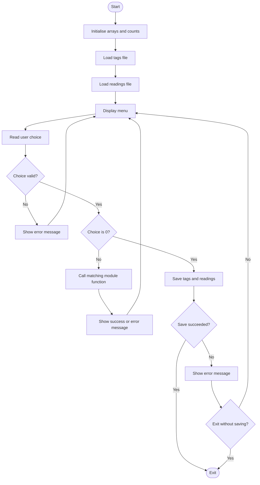
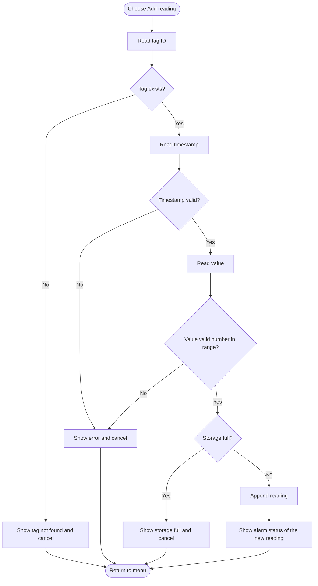
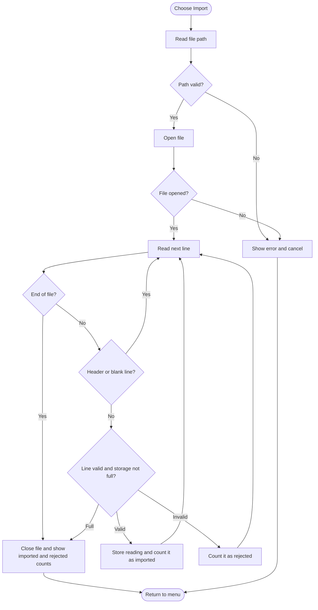

# Detailed Design: Process Data Logger and Alarm Analyzer

This document extends `project_proposal.md`. It describes the final design of the application and matches the implemented code, the unit tests and the Makefile in this repository.

---

# 1. Data Design

## 1.1 Constants

| Constant               | Value                      | Purpose                                              |
|------------------------|----------------------------|------------------------------------------------------|
| MAX_TAGS               | 50                         | Maximum number of tags stored                        |
| MAX_READINGS           | 1000                       | Maximum number of readings stored                    |
| MAX_TAG_ID_LEN         | 15                         | Maximum characters in a tag ID (buffer size is +1)   |
| MIN_TAG_ID_LEN         | 3                          | Minimum characters in a tag ID                       |
| MAX_DESC_LEN           | 47                         | Maximum characters in a tag description              |
| MAX_UNIT_LEN           | 7                          | Maximum characters in an engineering unit            |
| TIMESTAMP_LEN          | 19                         | Length of `YYYY-MM-DD HH:MM:SS`                      |
| MAX_LINE_LEN           | 128                        | Buffer size for reading one line of input or a file  |
| MIN_VALID_VALUE        | -100000.0                  | Lowest accepted reading or limit value               |
| MAX_VALID_VALUE        | 100000.0                   | Highest accepted reading or limit value              |
| SAMPLE_INTERVAL_SEC    | 60                         | Assumed time between readings (for time in alarm)    |
| TAGS_FILE              | "data/tags.txt"            | Relative path of the tag storage file                |
| READINGS_FILE          | "data/readings.txt"        | Relative path of the reading storage file            |
| REPORT_FILE            | "data/shift_report.txt"    | Relative path of the generated report                |

All paths are relative, so the project builds and runs on any machine.

## 1.2 Structure Definitions

### Structure: Tag_t

Purpose: Represents one measurement point (for example, a temperature transmitter) and its alarm limits.

```c
typedef struct
{
    char   id[MAX_TAG_ID_LEN + 1];
    char   description[MAX_DESC_LEN + 1];
    char   unit[MAX_UNIT_LEN + 1];
    double low_low;
    double low;
    double high;
    double high_high;
} Tag_t;
```

| Member      | C Type                       | Valid Range or Size                   | Description                    |
|-------------|------------------------------|---------------------------------------|--------------------------------|
| id          | char[MAX_TAG_ID_LEN + 1]     | 3 to 15 characters                    | Unique tag identifier          |
| description | char[MAX_DESC_LEN + 1]       | 1 to 47 characters                    | What the tag measures          |
| unit        | char[MAX_UNIT_LEN + 1]       | 1 to 7 characters                     | Engineering unit               |
| low_low     | double                       | MIN_VALID_VALUE to MAX_VALID_VALUE    | Low-Low alarm limit            |
| low         | double                       | MIN_VALID_VALUE to MAX_VALID_VALUE    | Low alarm limit                |
| high        | double                       | MIN_VALID_VALUE to MAX_VALID_VALUE    | High alarm limit               |
| high_high   | double                       | MIN_VALID_VALUE to MAX_VALID_VALUE    | High-High alarm limit          |

### Structure: Reading_t

Purpose: Represents one time-stamped measurement of a tag. The alarm status is calculated when needed and is not stored, so it can never become out of date if a tag's limits are edited.

```c
typedef struct
{
    char   tag_id[MAX_TAG_ID_LEN + 1];
    char   timestamp[TIMESTAMP_LEN + 1];
    double value;
} Reading_t;
```

| Member    | C Type                    | Valid Range or Size                | Description                       |
|-----------|---------------------------|------------------------------------|-----------------------------------|
| tag_id    | char[MAX_TAG_ID_LEN + 1]  | Must match an existing tag         | Tag this reading belongs to       |
| timestamp | char[TIMESTAMP_LEN + 1]   | `YYYY-MM-DD HH:MM:SS`              | When the reading was taken        |
| value     | double                    | MIN_VALID_VALUE to MAX_VALID_VALUE | Measured value in the tag's unit  |

### Structure: ReadingFilter_t

Purpose: Describes which readings the user wants to see. An empty text field means "no restriction" for that condition.

```c
typedef struct
{
    char          tag_id[MAX_TAG_ID_LEN + 1];
    int           filter_by_status;
    AlarmStatus_t status;
    char          start_time[TIMESTAMP_LEN + 1];
    char          end_time[TIMESTAMP_LEN + 1];
} ReadingFilter_t;
```

| Member           | C Type        | Valid Range or Size           | Description                                           |
|------------------|---------------|-------------------------------|-------------------------------------------------------|
| tag_id           | char[16]      | Empty or an existing tag ID   | Empty means all tags                                  |
| filter_by_status | int           | 0 or 1                        | 1 means only readings with the given alarm status     |
| status           | AlarmStatus_t | Any AlarmStatus_t value       | Alarm state to keep when `filter_by_status` is 1      |
| start_time       | char[20]      | Empty or a valid timestamp    | Earliest time to include; empty means no lower bound  |
| end_time         | char[20]      | Empty or a valid timestamp    | Latest time to include; empty means no upper bound    |

### Relationship Between Records

One tag has many readings (one-to-many). `Reading_t.tag_id` refers to `Tag_t.id`. A reading cannot be added for an unknown tag, and deleting a tag also deletes its readings.

### Storage in Memory

Records are held in fixed-size arrays (`Tag_t tags[MAX_TAGS]`, `Reading_t readings[MAX_READINGS]`) with a count for each. The arrays are declared in `main()` and passed to modules by pointer, so no global variables are needed. Dynamic memory is not used because the fixed limits are enough for this project.

## 1.3 Enumeration Definitions

### Enumeration: AlarmStatus_t

Purpose: Result of comparing a reading with its tag's alarm limits.

```c
typedef enum
{
    ALARM_NORMAL = 0,
    ALARM_LOW,
    ALARM_LOW_LOW,
    ALARM_HIGH,
    ALARM_HIGH_HIGH
} AlarmStatus_t;
```

| Constant         | Meaning                                         |
|------------------|-------------------------------------------------|
| ALARM_NORMAL     | Value is between the Low and High limits        |
| ALARM_LOW        | Value is at or below Low, above Low-Low         |
| ALARM_LOW_LOW    | Value is at or below Low-Low                    |
| ALARM_HIGH       | Value is at or above High, below High-High      |
| ALARM_HIGH_HIGH  | Value is at or above High-High                  |

**Classification rule (limits are inclusive):**

1. value <= low_low gives ALARM_LOW_LOW
2. value <= low gives ALARM_LOW
3. value >= high_high gives ALARM_HIGH_HIGH
4. value >= high gives ALARM_HIGH
5. otherwise ALARM_NORMAL

**Limit ordering rule for every tag:** low_low < low < high < high_high.

### Enumeration: SortField_t and SortOrder_t

```c
typedef enum
{
    SORT_BY_VALUE = 0,
    SORT_BY_TIMESTAMP
} SortField_t;

typedef enum
{
    SORT_ASCENDING = 0,
    SORT_DESCENDING
} SortOrder_t;
```

| Constant           | Meaning                          |
|--------------------|----------------------------------|
| SORT_BY_VALUE      | Sort readings by measured value  |
| SORT_BY_TIMESTAMP  | Sort readings by time            |
| SORT_ASCENDING     | Smallest or earliest first       |
| SORT_DESCENDING    | Largest or latest first          |

### Enumeration: Status_t

Purpose: One consistent return type for every function that can fail.

```c
typedef enum
{
    STATUS_SUCCESS = 0,
    STATUS_INVALID_ARGUMENT,
    STATUS_INVALID_INPUT,
    STATUS_DUPLICATE,
    STATUS_NOT_FOUND,
    STATUS_CAPACITY_FULL,
    STATUS_EMPTY,
    STATUS_FILE_OPEN_ERROR,
    STATUS_FILE_READ_ERROR,
    STATUS_FILE_WRITE_ERROR,
    STATUS_INVALID_FILE_DATA
} Status_t;
```

| Constant                  | Meaning                                                      |
|---------------------------|--------------------------------------------------------------|
| STATUS_SUCCESS            | Operation completed                                          |
| STATUS_INVALID_ARGUMENT   | A pointer argument was NULL or a count was invalid           |
| STATUS_INVALID_INPUT      | A value failed validation (format, range or length)          |
| STATUS_DUPLICATE          | A tag with the same ID already exists                        |
| STATUS_NOT_FOUND          | The requested tag or reading does not exist                  |
| STATUS_CAPACITY_FULL      | MAX_TAGS or MAX_READINGS has been reached                    |
| STATUS_EMPTY              | There is no data to process                                  |
| STATUS_FILE_OPEN_ERROR    | A file could not be opened                                   |
| STATUS_FILE_READ_ERROR    | Reading from a file failed                                   |
| STATUS_FILE_WRITE_ERROR   | Writing to a file failed                                     |
| STATUS_INVALID_FILE_DATA  | A file line was malformed or contained invalid values        |

## 1.4 Data Dictionary

| Data Item     | C Type    | Valid Range or Size                  | Validation Rule                                                                 | Description                       |
|---------------|-----------|--------------------------------------|---------------------------------------------------------------------------------|-----------------------------------|
| Tag ID        | char[16]  | 3 to 15 characters                   | First character is a letter; remaining are letters, digits or hyphen; unique    | Identifies a tag, for example TT-101 |
| Description   | char[48]  | 1 to 47 characters                   | Not empty; no comma or newline characters                                                | Text description of the tag       |
| Unit          | char[8]   | 1 to 7 characters                    | Not empty; no spaces or commas                                                            | Engineering unit, for example degC |
| Alarm limits  | double    | -100000.0 to 100000.0                | Numeric; low_low < low < high < high_high                                       | Four alarm thresholds per tag     |
| Timestamp     | char[20]  | Exactly 19 characters                | Format `YYYY-MM-DD HH:MM:SS`; year 2000 to 2100; valid month, day (with leap years), hour 0-23, minute 0-59, second 0-59 | Time of a reading |
| Reading value | double    | -100000.0 to 100000.0                | Numeric only; no text or empty input                                            | Measured process value            |
| Menu choice   | int       | Valid menu numbers only              | Whole number within the menu range                                              | User's menu selection             |
| Sort field    | SortField_t | SORT_BY_VALUE or SORT_BY_TIMESTAMP | Must be one of the enumeration values                                           | Field used for sorting            |
| Time range    | char[20] x2 | Two valid timestamps               | Both valid; start not later than end                                            | Filter boundaries                 |

---

# 2. Function Design (Tested Modules)

This part specifies the functions in the `statistics`, `alarm` and `validation` modules, which will be unit tested. Functions in the `tag`, `reading`, `file_handler` and `report` modules are specified in a later part.

All functions return `Status_t` (or write their result through an output parameter) so that no return value is ignored. Pointer arguments are checked for NULL.

## 2.1 Module: statistics (`statistics.c`, `statistics.h`)

Standard deviation is the **population** standard deviation (divide by n).

### Function: calculateMean

| Item | Specification |
|------|---------------|
| Prototype | `Status_t calculateMean(const double *values, int count, double *result);` |
| Purpose | Calculate the arithmetic mean of an array of values |
| Parameters | `values` (input): array of readings. `count` (input): number of values. `result` (output): the mean |
| Return values | `STATUS_SUCCESS`, `STATUS_INVALID_ARGUMENT` (NULL pointer), `STATUS_EMPTY` (count is 0 or negative) |
| Preconditions | `values` holds at least `count` valid numbers |
| Postconditions | `*result` holds the mean on success; unchanged on error |
| Related requirement | FR-12 |
| Planned tests | UT-01, UT-02 |

### Function: calculateStdDev

| Item | Specification |
|------|---------------|
| Prototype | `Status_t calculateStdDev(const double *values, int count, double *result);` |
| Purpose | Calculate the population standard deviation of an array of values |
| Parameters | `values` (input), `count` (input), `result` (output): the standard deviation |
| Return values | `STATUS_SUCCESS`, `STATUS_INVALID_ARGUMENT` (NULL pointer), `STATUS_EMPTY` (count is 0 or negative) |
| Preconditions | `values` holds at least `count` valid numbers |
| Postconditions | `*result` is 0.0 when `count` is 1; unchanged on error |
| Related requirement | FR-12 |
| Planned tests | UT-03, UT-04 |

### Functions: calculateMin and calculateMax

| Item | Specification |
|------|---------------|
| Prototypes | `Status_t calculateMin(const double *values, int count, double *result);` and `Status_t calculateMax(const double *values, int count, double *result);` |
| Purpose | Find the smallest and largest value |
| Return values | Same as `calculateMean` |
| Related requirement | FR-12 |

## 2.2 Module: alarm (`alarm.c`, `alarm.h`)

### Function: classifyReading

| Item | Specification |
|------|---------------|
| Prototype | `Status_t classifyReading(double value, const Tag_t *tag, AlarmStatus_t *status);` |
| Purpose | Decide the alarm state of a value using the tag's limits |
| Parameters | `value` (input): measured value. `tag` (input): tag with the alarm limits. `status` (output): the alarm state |
| Return values | `STATUS_SUCCESS`, `STATUS_INVALID_ARGUMENT` (NULL `tag` or `status`) |
| Preconditions | The tag's limits satisfy low_low < low < high < high_high |
| Postconditions | `*status` is set using the inclusive rule in section 1.3; unchanged on error |
| Related requirement | FR-09 |
| Planned tests | UT-05, UT-06, UT-07, UT-08 |

### Function: calculateTimeInAlarm

| Item | Specification |
|------|---------------|
| Prototype | `Status_t calculateTimeInAlarm(const Reading_t *readings, int count, const Tag_t *tag, int *seconds);` |
| Purpose | Calculate the total time a tag spent in any alarm state |
| Parameters | `readings` (input): reading array. `count` (input). `tag` (input). `seconds` (output): alarm duration |
| Return values | `STATUS_SUCCESS`, `STATUS_INVALID_ARGUMENT` (NULL pointer or negative count) |
| Preconditions | Readings are logged at the fixed interval `SAMPLE_INTERVAL_SEC` |
| Postconditions | `*seconds` = (number of readings of this tag that are not ALARM_NORMAL) x `SAMPLE_INTERVAL_SEC`; readings of other tags are ignored; 0 when there are none |
| Related requirement | FR-13 |
| Planned tests | UT-18 |

## 2.3 Module: validation (`validation.c`, `validation.h`)

### Function: validateTagId

| Item | Specification |
|------|---------------|
| Prototype | `Status_t validateTagId(const char *id);` |
| Purpose | Check that a tag ID has a legal format (uniqueness is checked by the tag module) |
| Parameters | `id` (input): the text to check |
| Return values | `STATUS_SUCCESS`, `STATUS_INVALID_ARGUMENT` (NULL), `STATUS_INVALID_INPUT` (bad length or characters) |
| Preconditions | `id` is a NUL-terminated string |
| Postconditions | No data is modified |
| Rule | 3 to 15 characters; first character is a letter; the rest are letters, digits or hyphen |
| Related requirement | FR-02 |
| Planned tests | UT-09, UT-10, UT-11, UT-12 |

### Function: validateTimestamp

| Item | Specification |
|------|---------------|
| Prototype | `Status_t validateTimestamp(const char *timestamp);` |
| Purpose | Check format and calendar validity of `YYYY-MM-DD HH:MM:SS` |
| Parameters | `timestamp` (input): the text to check |
| Return values | `STATUS_SUCCESS`, `STATUS_INVALID_ARGUMENT` (NULL), `STATUS_INVALID_INPUT` |
| Preconditions | `timestamp` is a NUL-terminated string |
| Postconditions | No data is modified |
| Rule | Exactly 19 characters; separators at the fixed positions; year 2000 to 2100; month 1 to 12; day valid for the month including leap years; hour 0 to 23; minute and second 0 to 59 |
| Related requirements | FR-06, FR-08 |
| Planned tests | UT-13, UT-14, UT-15, UT-16 |

### Function: validateAlarmLimits

| Item | Specification |
|------|---------------|
| Prototype | `Status_t validateAlarmLimits(double low_low, double low, double high, double high_high);` |
| Purpose | Check that the four limits are in range and strictly increasing |
| Return values | `STATUS_SUCCESS`, `STATUS_INVALID_INPUT` |
| Rule | Each limit between `MIN_VALID_VALUE` and `MAX_VALID_VALUE`; low_low < low < high < high_high |
| Related requirements | FR-01, FR-03 |
| Planned tests | UT-17 |

### Function: parseDouble

| Item | Specification |
|------|---------------|
| Prototype | `Status_t parseDouble(const char *text, double *value);` |
| Purpose | Convert text to a number and reject anything that is not a clean number in range |
| Parameters | `text` (input): text typed by the user or read from a file. `value` (output): the number |
| Return values | `STATUS_SUCCESS`, `STATUS_INVALID_ARGUMENT` (NULL), `STATUS_INVALID_INPUT` (empty, extra characters or out of range) |
| Postconditions | `*value` is set only on success |
| Rule | Whole text is one number; between `MIN_VALID_VALUE` and `MAX_VALID_VALUE` |
| Related requirements | FR-06, FR-08 |
| Planned tests | UT-19, UT-20 |

---

# 3. Unit Tests

The project has **62 unit tests** in 7 test files (`test_statistics.cpp`, `test_alarm.cpp`, `test_validation.cpp`, `test_tag.cpp`, `test_reading.cpp`, `test_file_handler.cpp` and `test_report.cpp`). They cover 28 functions and include positive, negative and boundary cases. UT-01 to UT-20 were planned in the first design; UT-21 to UT-62 were added during implementation to cover record handling, file handling and reports. The test ID is written in a comment above every test.

| Test ID | Function | Category | Input or Condition | Expected Result | Requirement ID |
|---------|----------|----------|--------------------|-----------------|----------------|
| UT-01 | calculateMean | Positive | values 1, 2, 3 | 2.0, STATUS_SUCCESS | FR-12 |
| UT-02 | calculateMean | Negative | count 0 | STATUS_EMPTY, result unchanged | FR-12 |
| UT-03 | calculateStdDev | Positive | values 2, 4, 4, 4, 5, 5, 7, 9 | 2.0, STATUS_SUCCESS | FR-12 |
| UT-04 | calculateStdDev | Boundary | one value | 0.0, STATUS_SUCCESS | FR-12 |
| UT-05 | classifyReading | Positive | value between low and high | ALARM_NORMAL | FR-09 |
| UT-06 | classifyReading | Boundary | value equal to high | ALARM_HIGH | FR-09 |
| UT-07 | classifyReading | Boundary | value equal to low_low | ALARM_LOW_LOW | FR-09 |
| UT-08 | classifyReading | Negative | NULL tag | STATUS_INVALID_ARGUMENT, status unchanged | FR-09, FR-16 |
| UT-09 | validateTagId | Positive | "TT-101" | STATUS_SUCCESS | FR-02 |
| UT-10 | validateTagId | Negative | "1TT" (starts with a digit) | STATUS_INVALID_INPUT | FR-02 |
| UT-11 | validateTagId | Boundary | 3-character ID "TT1" | STATUS_SUCCESS | FR-02 |
| UT-12 | validateTagId | Boundary | 16-character ID | STATUS_INVALID_INPUT | FR-02 |
| UT-13 | validateTimestamp | Positive | "2026-11-07 08:30:00" | STATUS_SUCCESS | FR-06 |
| UT-14 | validateTimestamp | Negative | month 13 | STATUS_INVALID_INPUT | FR-08 |
| UT-15 | validateTimestamp | Boundary | "2024-02-29 00:00:00" (leap year) | STATUS_SUCCESS | FR-08 |
| UT-16 | validateTimestamp | Boundary | "2025-02-29 00:00:00" | STATUS_INVALID_INPUT | FR-08 |
| UT-17 | validateAlarmLimits | Negative | high not above low | STATUS_INVALID_INPUT | FR-01, FR-03 |
| UT-18 | calculateTimeInAlarm | Positive | 5 readings, 2 in alarm | 120 seconds | FR-13 |
| UT-19 | parseDouble | Negative | "abc" | STATUS_INVALID_INPUT, value unchanged | FR-08 |
| UT-20 | parseDouble | Boundary | "100000.1" | STATUS_INVALID_INPUT | FR-08 |
| UT-21 | addTag | Positive | valid tag | STATUS_SUCCESS, count 1, ID stored | FR-01 |
| UT-22 | addTag | Negative | same ID added twice | STATUS_DUPLICATE, count stays 1 | FR-02 |
| UT-23 | addTag | Boundary | array already holds MAX_TAGS tags | STATUS_CAPACITY_FULL | FR-01 |
| UT-24 | addTag | Negative | limits not in increasing order | STATUS_INVALID_INPUT, count 0 | FR-01 |
| UT-25 | findTagById | Negative | tag does not exist | STATUS_NOT_FOUND, index unchanged | FR-05 |
| UT-26 | editTag | Positive | new description and high limit | Values changed, ID unchanged | FR-03 |
| UT-27 | deleteTag | Positive | delete the middle of three tags | Count 2, later tag shifted up | FR-04 |
| UT-28 | addReading | Positive | valid tag, timestamp and value | STATUS_SUCCESS, count 1 | FR-06 |
| UT-29 | addReading | Negative | unknown tag | STATUS_NOT_FOUND, count 0 | FR-06, FR-08 |
| UT-30 | addReading | Negative | timestamp with month 13 | STATUS_INVALID_INPUT, count 0 | FR-08 |
| UT-31 | addReading | Boundary | array already holds MAX_READINGS | STATUS_CAPACITY_FULL | FR-06 |
| UT-32 | deleteReadingsByTag | Positive | 2 readings of TT-101, 1 of TT-102; delete TT-101 | removed 2, TT-102 reading kept | FR-04 |
| UT-33 | filterReadings | Positive | tag TT-101 and status HIGH | 1 reading (85.0) | FR-10 |
| UT-34 | filterReadings | Boundary | range 09:00:00 to 10:00:00 | Both end times included, 2 readings | FR-10 |
| UT-35 | filterReadings | Negative | start time after end time | STATUS_INVALID_INPUT | FR-10 |
| UT-36 | sortReadings | Positive | by value, ascending | 30, 50, 70 | FR-11 |
| UT-37 | sortReadings | Positive | by timestamp, descending | Latest reading first | FR-11 |
| UT-38 | sortReadings | Negative | invalid sort field | STATUS_INVALID_ARGUMENT | FR-11 |
| UT-39 | getValuesForTag | Positive | 2 values of TT-101 and 1 of TT-102 | 11.0 and 22.0 in order | FR-12 |
| UT-40 | getValuesForTag | Negative | tag without readings | STATUS_EMPTY, count unchanged | FR-12 |
| UT-41 | saveTags / loadTags | Positive | save 2 tags and load them again | Same 2 tags, 0 rejected | FR-15 |
| UT-42 | loadTags | Negative | file does not exist | STATUS_FILE_OPEN_ERROR | FR-15, FR-16 |
| UT-43 | loadTags | Negative | 6-field line, reversed limits, blank line, 2 valid lines | 2 tags loaded, 2 rejected | FR-15, FR-16 |
| UT-44 | loadTags | Negative | every line invalid | STATUS_INVALID_FILE_DATA | FR-16 |
| UT-45 | loadTags | Boundary | line of 300 characters, then a valid line | 1 rejected, 1 loaded | FR-16 |
| UT-46 | saveReadings / importReadingsCsv | Positive | save 2 readings and import them again | Same 2 readings, 0 rejected | FR-15 |
| UT-47 | importReadingsCsv | Negative | header, 2 valid lines, 3 invalid lines | 2 imported, 3 rejected | FR-07, FR-08 |
| UT-48 | importReadingsCsv | Boundary | only one free slot, 3 valid lines | STATUS_CAPACITY_FULL, 1 imported | FR-07 |
| UT-49 | importReadingsCsv | Negative | file does not exist | STATUS_FILE_OPEN_ERROR | FR-07, FR-16 |
| UT-50 | saveTags | Negative | folder does not exist | STATUS_FILE_OPEN_ERROR | FR-15, FR-16 |
| UT-51 | statusToMessage | Negative | unknown status value | "Unknown error." | FR-16 |
| UT-52 | alarmStatusToText | Positive | ALARM_HIGH_HIGH and ALARM_NORMAL | "HIGH-HIGH" and "NORMAL" | FR-09 |
| UT-53 | printTags | Negative | no tags | STATUS_EMPTY | FR-05 |
| UT-54 | printTags | Positive | 2 tags | Output lists the IDs and descriptions | FR-05 |
| UT-55 | printReadings | Positive | one reading of 85.0 | Output shows 85.00 and HIGH | FR-10 |
| UT-56 | printReadings | Negative | no readings | STATUS_EMPTY | FR-10 |
| UT-57 | printTagStatistics | Positive | values 10, 20, 30 | Mean 20.00, std dev 8.16 | FR-12 |
| UT-58 | printTagStatistics | Negative | tag has no readings | STATUS_EMPTY | FR-12 |
| UT-59 | printAlarmSummary | Positive | 5 readings, 2 in alarm; second tag has none | "Time in alarm : 120 s", "High: 1", "No readings" | FR-09, FR-13 |
| UT-60 | saveShiftReport | Positive | 3 readings of one tag | File shows period, mean and a "No readings" note | FR-14 |
| UT-61 | saveShiftReport | Negative | folder does not exist | STATUS_FILE_OPEN_ERROR | FR-14, FR-16 |
| UT-62 | saveShiftReport | Negative | no tags | STATUS_EMPTY | FR-14 |

---

# 4. Function Design (Other Modules)

These functions follow the same rules as section 2: every function returns `Status_t`, results come back through output parameters, and pointer arguments are checked for NULL. In every row, "Postcondition: unchanged on error" applies to all output parameters and arrays.

**Common preconditions:** pointer arguments are not NULL, counts are within `0` to the array capacity, and arrays hold at least `count` valid items. **Common postconditions:** output parameters are written only when the function returns `STATUS_SUCCESS` (the load and import functions also report their counts when some lines were rejected).

## 4.1 Module: tag (`tag.c`, `tag.h`)

| Function | Behaviour | Return values | Req. |
|----------|-----------|---------------|------|
| `Status_t addTag(Tag_t *tags, int *tag_count, const Tag_t *new_tag);` | Validates the ID, description, unit and limits, rejects a duplicate ID or a full array, then appends a copy of the tag. Postcondition: `*tag_count` increases by 1 on success. | SUCCESS, INVALID_ARGUMENT, INVALID_INPUT, DUPLICATE, CAPACITY_FULL | FR-01, FR-02 |
| `Status_t findTagById(const Tag_t *tags, int tag_count, const char *id, int *index);` | Searches for the ID. Postcondition: `*index` holds the position on success. | SUCCESS, INVALID_ARGUMENT, NOT_FOUND | FR-05 |
| `Status_t editTag(Tag_t *tags, int tag_count, const char *id, const Tag_t *updated);` | Validates `updated`, then replaces the description, unit and four limits of the tag with this ID. The ID itself cannot be changed. | SUCCESS, INVALID_ARGUMENT, INVALID_INPUT, NOT_FOUND | FR-03 |
| `Status_t deleteTag(Tag_t *tags, int *tag_count, const char *id);` | Removes the tag by shifting later tags up one place. Postcondition: `*tag_count` decreases by 1. Readings are removed separately: `main` calls `deleteTag` first and, on success, `deleteReadingsByTag` for the same ID. | SUCCESS, INVALID_ARGUMENT, NOT_FOUND | FR-04 |

Listing all tags is done by `printTags` in the report module.

## 4.2 Module: reading (`reading.c`, `reading.h`)

| Function | Behaviour | Return values | Req. |
|----------|-----------|---------------|------|
| `Status_t addReading(Reading_t *readings, int *reading_count, const Tag_t *tags, int tag_count, const char *tag_id, const char *timestamp, double value);` | Checks that the tag exists, the timestamp is valid, the value is in range and the array is not full, then appends the reading. | SUCCESS, INVALID_ARGUMENT, INVALID_INPUT, NOT_FOUND, CAPACITY_FULL | FR-06, FR-08 |
| `Status_t deleteReadingsByTag(Reading_t *readings, int *reading_count, const char *tag_id, int *removed);` | Removes every reading of the tag and closes the gaps. Postcondition: `*removed` holds how many were deleted (0 is allowed). | SUCCESS, INVALID_ARGUMENT | FR-04 |
| `Status_t filterReadings(const Reading_t *readings, int count, const Tag_t *tags, int tag_count, const ReadingFilter_t *filter, Reading_t *out, int *out_count);` | Copies the readings that match all active conditions into `out` (the caller provides room for `MAX_READINGS`). Time comparison uses `strcmp`, because the timestamp format sorts alphabetically. An empty result is valid (`*out_count` is 0). | SUCCESS, INVALID_ARGUMENT, INVALID_INPUT (bad timestamp or start later than end) | FR-10 |
| `Status_t sortReadings(Reading_t *readings, int count, SortField_t field, SortOrder_t order);` | Sorts the array in place with a stable insertion sort (the array is small, so simplicity wins). | SUCCESS, INVALID_ARGUMENT (NULL, negative count or invalid enum value) | FR-11 |
| `Status_t getValuesForTag(const Reading_t *readings, int count, const char *tag_id, double *values, int *value_count);` | Copies the values of one tag into a plain array so the statistics functions can use it. Postcondition: `*value_count` holds how many were copied. | SUCCESS, INVALID_ARGUMENT, EMPTY (the tag has no readings) | FR-12 |

## 4.3 Module: file_handler (`file_handler.c`, `file_handler.h`)

The readings file and a user's CSV import file use the same format, so one function loads both and there is no duplicated parsing logic.

| Function | Behaviour | Return values | Req. |
|----------|-----------|---------------|------|
| `Status_t saveTags(const char *path, const Tag_t *tags, int tag_count);` | Rewrites the whole tags file, one line per tag. Every `fprintf` result and the final `fclose` are checked. | SUCCESS, INVALID_ARGUMENT, FILE_OPEN_ERROR, FILE_WRITE_ERROR | FR-15 |
| `Status_t loadTags(const char *path, Tag_t *tags, int *tag_count, int *rejected);` | Reads each line with `fgets`, skips blank lines, parses 7 fields and validates each with the validation module. Invalid or duplicate lines are skipped and counted in `*rejected`. | SUCCESS, INVALID_ARGUMENT, FILE_OPEN_ERROR, FILE_READ_ERROR, INVALID_FILE_DATA (every non-blank line was rejected) | FR-15, FR-16 |
| `Status_t saveReadings(const char *path, const Reading_t *readings, int reading_count);` | Rewrites the whole readings file, one line per reading. | SUCCESS, INVALID_ARGUMENT, FILE_OPEN_ERROR, FILE_WRITE_ERROR | FR-15 |
| `Status_t importReadingsCsv(const char *path, Reading_t *readings, int *reading_count, const Tag_t *tags, int tag_count, int *imported, int *rejected);` | Reads lines of `tag_id,timestamp,value`. An optional first line starting with `tag_id` is treated as a header and skipped. Each line is validated; bad lines are skipped and counted. If the array becomes full, the import stops and keeps what was added. Also used at startup to load the readings file. | SUCCESS, INVALID_ARGUMENT, FILE_OPEN_ERROR, FILE_READ_ERROR, CAPACITY_FULL, INVALID_FILE_DATA (every non-blank line was rejected) | FR-07, FR-08, FR-15 |

## 4.4 Module: report (`report.c`, `report.h`)

| Function | Behaviour | Return values | Req. |
|----------|-----------|---------------|------|
| `Status_t printTags(const Tag_t *tags, int tag_count);` | Prints a table of all tags with their limits. | SUCCESS, INVALID_ARGUMENT, EMPTY | FR-05 |
| `Status_t printReadings(const Reading_t *readings, int count, const Tag_t *tags, int tag_count);` | Prints a table of readings with the alarm status of each. | SUCCESS, INVALID_ARGUMENT, EMPTY | FR-10 |
| `Status_t printTagStatistics(const Tag_t *tag, const Reading_t *readings, int count);` | Prints minimum, maximum, mean and standard deviation for one tag. | SUCCESS, INVALID_ARGUMENT, EMPTY | FR-12 |
| `Status_t printAlarmSummary(const Tag_t *tags, int tag_count, const Reading_t *readings, int count);` | Prints, for every tag, the number of readings in each alarm state and the time in alarm. | SUCCESS, INVALID_ARGUMENT, EMPTY | FR-09, FR-13 |
| `Status_t saveShiftReport(const char *path, const Tag_t *tags, int tag_count, const Reading_t *readings, int count);` | Writes the full shift report: for each tag, the reading count, statistics, alarm counts and time in alarm. Tags with no readings show "No readings". | SUCCESS, INVALID_ARGUMENT, EMPTY, FILE_OPEN_ERROR, FILE_WRITE_ERROR | FR-14 |
| `const char *statusToMessage(Status_t status);` | Returns a fixed user-friendly message for a status code, never NULL; unknown values give "Unknown error". | Not applicable (returns text) | FR-16 |
| `const char *alarmStatusToText(AlarmStatus_t status);` | Returns the text for an alarm state (`NORMAL`, `LOW`, `LOW-LOW`, `HIGH`, `HIGH-HIGH`); unknown values give `UNKNOWN`. Never returns NULL. | Not applicable (returns text) | FR-09 |

`printAlarmSummary` and `saveShiftReport` share one internal routine for the per-tag summary, so the logic is written once.

## 4.5 Module: validation (additional functions)

| Function | Behaviour | Return values | Req. |
|----------|-----------|---------------|------|
| `Status_t readLine(char *buffer, int size);` | Reads one line with `fgets`, removes the newline, and detects a line that was too long (the rest is discarded). Replaces unsafe input functions. | SUCCESS, INVALID_ARGUMENT, INVALID_INPUT (too long or input closed) | FR-16 |
| `Status_t validateMenuChoice(const char *text, int min, int max, int *choice);` | Accepts only a whole number between `min` and `max`. | SUCCESS, INVALID_ARGUMENT, INVALID_INPUT | FR-16 |
| `Status_t validateDescription(const char *text);` | 1 to 47 characters, no comma or newline. | SUCCESS, INVALID_ARGUMENT, INVALID_INPUT | FR-01 |
| `Status_t validateUnit(const char *text);` | 1 to 7 characters, no spaces or commas. | SUCCESS, INVALID_ARGUMENT, INVALID_INPUT | FR-01 |

---

# 5. Input-Validation Plan

| Input | Source | Validation Rule | Invalid Example | Expected Error Behaviour |
|-------|--------|-----------------|-----------------|--------------------------|
| Menu choice | User | Whole number within the menu range | `abc`, `9`, empty | Error message; menu shown again |
| Tag ID | User, file | 3 to 15 characters; starts with a letter; letters, digits, hyphen | `1TT`, `T`, 16 characters | Operation cancelled; file line skipped |
| Duplicate tag ID | User, file | ID not already stored | `TT-101` added twice | DUPLICATE message; file line skipped |
| Description | User, file | 1 to 47 characters; no comma or newline | empty, `Boiler, top` | Operation cancelled; file line skipped |
| Unit | User, file | 1 to 7 characters; no spaces or commas | `deg C` | Operation cancelled; file line skipped |
| Alarm limits | User, file | Numeric; in range; low_low < low < high < high_high | `50, 40, 30, 20`; `hot` | Operation cancelled; file line skipped |
| Timestamp | User, file | `YYYY-MM-DD HH:MM:SS` with valid calendar values | `2025-02-29 10:00:00`, `7/11/26` | Reading rejected |
| Reading value | User, file | One number in range, no extra text | `abc`, empty, `1e9` | Reading rejected |
| Reading's tag | User, file | Tag must already exist | `XX-999` | NOT_FOUND message; line skipped |
| Time range | User | Both timestamps valid; start not after end | start later than end | Error message; filter not applied |
| Sort choice | User | One of the listed options | `3` when only 1 and 2 exist | Error message; menu shown again |
| File path | User | Not empty; shorter than `MAX_LINE_LEN` | empty | Error message; import cancelled |
| Over-long input line | User | Shorter than `MAX_LINE_LEN` | 300 characters | Rest of the line discarded; error message |
| Data file line | File | Exactly 7 fields (tags) or 3 fields (readings), each validated | `TT-101,2026-11-07` | Line skipped and counted; summary shown |
| Storage capacity | User, file | Fewer than `MAX_TAGS` or `MAX_READINGS` records | the 1001st reading | CAPACITY_FULL message; import stops |

**Validation strategy:**

1. All text input is read with `readLine` (`fgets`); `scanf` and `gets` are never used.
2. Each value is checked by the validation module before it is stored, so invalid data never enters the arrays.
3. File data goes through the same validators as typed data, so there is one set of rules.
4. When user input is invalid, the program shows the message from `statusToMessage`, changes no data and returns to the menu. The program never crashes or exits because of bad input.

---

# 6. File-Handling Plan

## 6.1 File Summary

| File | Purpose | Format | Created By | Read By | Updated By |
|------|---------|--------|------------|---------|------------|
| `data/tags.txt` | Stores all tags and limits | Text | `saveTags` on first save | `loadTags` at startup | `saveTags` (rewrites the file) |
| `data/readings.txt` | Stores all readings | Text (CSV) | `saveReadings` on first save | `importReadingsCsv` at startup | `saveReadings` (rewrites the file) |
| User CSV file | Readings exported from a logger | Text (CSV) | The user (outside the program) | `importReadingsCsv` | Never (read only) |
| `data/shift_report.txt` | Shift report for printing or sharing | Text | `saveShiftReport` | The user | `saveShiftReport` (overwrites) |

Sample files `data/sample_tags.txt` and `data/sample_readings.csv` are committed so the program can be demonstrated.

## 6.2 Record Format

Tags file, one tag per line (7 comma-separated fields):

```
id,description,unit,low_low,low,high,high_high
TT-101,Boiler outlet temperature,degC,40.0,50.0,120.0,140.0
```

Readings file and CSV import, one reading per line (3 fields). An optional header line is allowed in an import:

```
tag_id,timestamp,value
TT-101,2026-11-07 08:00:00,72.5000
```

Numbers are written with 4 decimal places. Blank lines are ignored. Descriptions and units cannot contain commas, which keeps parsing simple and safe.

## 6.3 File Operations

| Operation | Function or Module | C Library Function | Failure Handling |
|-----------|--------------------|--------------------|------------------|
| Create or open | file_handler, report | `fopen` ("r" to read, "w" to write) | NULL result gives FILE_OPEN_ERROR |
| Read | file_handler | `fgets` | `ferror` check gives FILE_READ_ERROR |
| Write | file_handler, report | `fprintf` | Negative result gives FILE_WRITE_ERROR |
| Update | file_handler | `fopen` "w" (rewrite whole file) | Same as write |
| Close | file_handler, report | `fclose` | Non-zero result gives FILE_WRITE_ERROR when saving |

## 6.4 File Error Conditions

| Error Condition | Detection Method | Expected Behaviour |
|-----------------|------------------|--------------------|
| File does not exist | `fopen` returns NULL on load | At startup: "No saved data found", start with empty data. For a user import: show an error and return to the menu |
| File cannot be opened | `fopen` returns NULL on save | Show the error with the file path; stay in the menu so the user can retry |
| File is empty | No non-blank lines read | Load succeeds with 0 records |
| File contains invalid data | Line fails parsing or validation | Skip the line, count it, show "N lines rejected" |
| Read or write fails | `ferror`, `fprintf` or `fclose` result | Show the error and stay in the menu; data in memory is kept |

---

# 7. Error-Handling Strategy

## 7.1 Status Representation

All functions use the `Status_t` enumeration defined in section 1.3. Every returned status is checked by the caller and none is ignored. `statusToMessage` converts a status to text for the user.

## 7.2 Error Catalogue

| Error ID | Error Condition | Detection Location | Returned Status | User-Facing Behaviour |
|----------|-----------------|--------------------|-----------------|-----------------------|
| ERR-01 | Invalid menu choice | `validateMenuChoice` | INVALID_INPUT | "Invalid choice" and the menu is shown again |
| ERR-02 | Invalid tag ID, description, unit or limits | validation module | INVALID_INPUT | Message; operation cancelled |
| ERR-03 | Duplicate tag ID | `addTag` | DUPLICATE | "Tag already exists" |
| ERR-04 | Tag or record not found | `findTagById`, `addReading` | NOT_FOUND | "Tag not found" |
| ERR-05 | Tag or reading storage is full | `addTag`, `addReading`, import | CAPACITY_FULL | "Storage full"; import stops and reports how many were added |
| ERR-06 | Invalid timestamp or reading value | `validateTimestamp`, `parseDouble` | INVALID_INPUT | Reading rejected with a message |
| ERR-07 | NULL pointer or invalid argument | Start of every function | INVALID_ARGUMENT | Internal error message; operation skipped |
| ERR-08 | No data to process | statistics, report functions | EMPTY | "No readings available" |
| ERR-09 | File cannot be opened | file_handler | FILE_OPEN_ERROR | Message with the path; startup continues with empty data |
| ERR-10 | Invalid file data | loaders, import | INVALID_FILE_DATA or rejected count | Bad lines skipped; count shown |
| ERR-11 | File read or write failure | file_handler, report | FILE_READ_ERROR, FILE_WRITE_ERROR | Message; stay in the menu |
| ERR-12 | Over-long input line | `readLine` | INVALID_INPUT | Rest of the line discarded; message |

## 7.3 Recovery Strategy

- Bad user input never changes data. The program reports the problem and returns to the menu.
- A missing data file at startup is treated as a first run, and the program starts with empty data.
- Corrupt lines in a file are skipped one at a time, so one bad line cannot block the rest of the file.
- If saving fails on exit, the program shows the error and asks "Exit without saving? (y/n)". Answering no returns to the menu so the user can fix the problem and try again, and the data is never lost silently. If the input has been closed (end of file) nobody can answer, so the program exits.
- Known limitation: saving rewrites the whole file, so a failure in the middle of a save can leave a damaged file. Writing to a temporary file and then renaming it is listed as a future enhancement.

---

# 8. Module Descriptions and Dependencies

## 8.1 Shared Definitions

`common.h` holds all shared types and constants: the constants from section 1.1, `Tag_t`, `Reading_t`, `ReadingFilter_t`, `AlarmStatus_t`, `SortField_t`, `SortOrder_t` and `Status_t`. Every other header includes it. It contains no function implementations.

## 8.2 Module Summary

| Module | Depends On | Public Functions | Data Used |
|--------|-----------|------------------|-----------|
| main | all modules | `main` only (menu and control flow) | Owns `tags`, `readings`, `view_buffer` and their counts |
| validation | common | `validateTagId`, `validateTimestamp`, `validateAlarmLimits`, `validateDescription`, `validateUnit`, `parseDouble`, `validateMenuChoice`, `readLine` | Input text only |
| statistics | common | `calculateMean`, `calculateStdDev`, `calculateMin`, `calculateMax` | Arrays of doubles |
| alarm | common | `classifyReading`, `calculateTimeInAlarm` | `Tag_t`, `Reading_t` |
| tag | validation, common | `addTag`, `findTagById`, `editTag`, `deleteTag` | `Tag_t` array |
| reading | validation, tag, alarm, common | `addReading`, `deleteReadingsByTag`, `filterReadings`, `sortReadings`, `getValuesForTag` | `Reading_t` array, `ReadingFilter_t` |
| file_handler | validation, tag, reading, common | `saveTags`, `loadTags`, `saveReadings`, `importReadingsCsv` | Data files |
| report | statistics, alarm, reading, tag, common | `printTags`, `printReadings`, `printTagStatistics`, `printAlarmSummary`, `saveShiftReport`, `statusToMessage`, `alarmStatusToText` | Read-only access to arrays |

## 8.3 Dependency Rules

1. Dependencies only point downwards (`main` to feature modules, feature modules to `validation`, `statistics` and `alarm`, all to `common`). There are no circular dependencies.
2. `validation`, `statistics` and `alarm` do not depend on other feature modules, so they can be unit tested on their own.
3. No global variables: `main` owns the arrays and passes them to functions by pointer.
4. Each `.c` file includes its own header first, then other headers, and only the headers it needs.


## 8.4 Detailed Module Descriptions

### Module: main

- **Source and header:** `src/main.c` (no header)
- **Purpose:** Entry point. Loads the saved data, shows the menus, calls the other modules and saves the data on exit.
- **Responsibilities:** Create the data arrays, load tags and readings, display the main and tag menus, validate menu choices, ask for input, call module functions, show success and error messages, save on exit.
- **Public functions:** `main`
- **Data owned:** `tags[MAX_TAGS]`, `readings[MAX_READINGS]`, `view_buffer[MAX_READINGS]` and their counts, passed to other modules by pointer.
- **Dependencies:** all modules
- **Possible errors:** Shows the message for any `Status_t` through `statusToMessage`.

### Module: validation

- **Source and header:** `src/validation.c`, `include/validation.h`
- **Purpose:** One place for all input rules, used for typed input and for file data.
- **Responsibilities:** Validate tag IDs, timestamps, alarm limits, descriptions and units; convert text to numbers safely; check menu choices; read lines without overflow.
- **Public functions:** `validateTagId`, `validateTimestamp`, `validateAlarmLimits`, `validateDescription`, `validateUnit`, `parseDouble`, `validateMenuChoice`, `readLine`
- **Data used:** Text and numbers passed in; no stored data.
- **Dependencies:** common
- **Possible errors:** `STATUS_INVALID_ARGUMENT`, `STATUS_INVALID_INPUT`

### Module: statistics

- **Source and header:** `src/statistics.c`, `include/statistics.h`
- **Purpose:** Numeric summary of an array of values.
- **Responsibilities:** Minimum, maximum, mean and population standard deviation.
- **Public functions:** `calculateMean`, `calculateStdDev`, `calculateMin`, `calculateMax`
- **Data used:** Arrays of doubles.
- **Dependencies:** common
- **Possible errors:** `STATUS_INVALID_ARGUMENT`, `STATUS_EMPTY`

### Module: alarm

- **Source and header:** `src/alarm.c`, `include/alarm.h`
- **Purpose:** Decide whether a reading is in alarm.
- **Responsibilities:** Classify a value against the four limits of a tag (inclusive limits); calculate the time a tag spent in alarm.
- **Public functions:** `classifyReading`, `calculateTimeInAlarm`
- **Data used:** `Tag_t` limits and `Reading_t` values.
- **Dependencies:** common
- **Possible errors:** `STATUS_INVALID_ARGUMENT`

### Module: tag

- **Source and header:** `src/tag.c`, `include/tag.h`
- **Purpose:** Manage the measurement tags.
- **Responsibilities:** Add (with validation, duplicate and capacity checks), find, edit and delete tags.
- **Public functions:** `addTag`, `findTagById`, `editTag`, `deleteTag`
- **Data used:** The tag array and its count (owned by `main`).
- **Dependencies:** validation, common
- **Possible errors:** `STATUS_INVALID_ARGUMENT`, `STATUS_INVALID_INPUT`, `STATUS_DUPLICATE`, `STATUS_NOT_FOUND`, `STATUS_CAPACITY_FULL`

### Module: reading

- **Source and header:** `src/reading.c`, `include/reading.h`
- **Purpose:** Manage the process readings.
- **Responsibilities:** Add readings (tag must exist), delete the readings of a tag, filter by tag, alarm status and time range, sort, and extract the values of one tag.
- **Public functions:** `addReading`, `deleteReadingsByTag`, `filterReadings`, `sortReadings`, `getValuesForTag`
- **Data used:** The reading array and its count (owned by `main`), `ReadingFilter_t`.
- **Dependencies:** validation, tag, alarm, common
- **Possible errors:** `STATUS_INVALID_ARGUMENT`, `STATUS_INVALID_INPUT`, `STATUS_NOT_FOUND`, `STATUS_CAPACITY_FULL`, `STATUS_EMPTY`

### Module: file_handler

- **Source and header:** `src/file_handler.c`, `include/file_handler.h`
- **Purpose:** Store and load the data.
- **Responsibilities:** Save and load tags and readings, import CSV files, skip and count invalid lines, check every file operation.
- **Public functions:** `saveTags`, `loadTags`, `saveReadings`, `importReadingsCsv`
- **Data used:** `data/tags.txt`, `data/readings.txt` and user CSV files.
- **Dependencies:** validation, tag, reading, common
- **Possible errors:** `STATUS_INVALID_ARGUMENT`, `STATUS_FILE_OPEN_ERROR`, `STATUS_FILE_READ_ERROR`, `STATUS_FILE_WRITE_ERROR`, `STATUS_INVALID_FILE_DATA`, `STATUS_CAPACITY_FULL`

### Module: report

- **Source and header:** `src/report.c`, `include/report.h`
- **Purpose:** Present results to the user.
- **Responsibilities:** Print tag and reading tables, per-tag statistics and the alarm summary; write the shift report file; provide the texts for status codes and alarm states.
- **Public functions:** `printTags`, `printReadings`, `printTagStatistics`, `printAlarmSummary`, `saveShiftReport`, `statusToMessage`, `alarmStatusToText`
- **Data used:** Read-only access to tags and readings.
- **Dependencies:** statistics, alarm, reading, tag, common
- **Possible errors:** `STATUS_INVALID_ARGUMENT`, `STATUS_EMPTY`, `STATUS_FILE_OPEN_ERROR`, `STATUS_FILE_WRITE_ERROR`

---

# 9. Application Flow

## 9.1 Main Menu

| Choice | Menu Item | Main Functions Called |
|--------|-----------|-----------------------|
| 1 | Manage tags (add, edit, delete, search, list) | `addTag`, `editTag`, `deleteTag`, `deleteReadingsByTag`, `findTagById`, `printTags` |
| 2 | Add reading | `addReading` |
| 3 | Import readings from CSV | `importReadingsCsv` |
| 4 | View, filter and sort readings | `filterReadings`, `sortReadings`, `printReadings` |
| 5 | Show statistics for a tag | `printTagStatistics` |
| 6 | Show alarm summary | `printAlarmSummary` |
| 7 | Generate shift report | `saveShiftReport` |
| 8 | Save data | `saveTags`, `saveReadings` |
| 0 | Save and exit | `saveTags`, `saveReadings` |

Valid menu choices are 0 to 8.

## 9.2 Main Application Flowchart



## 9.3 Operation Flow: Add Reading



## 9.4 Operation Flow: Import Readings from CSV



---

# 10. Unit-Test Setup and Cleanup

## 10.1 Test Files and Mapping

| Test File | Module Tested | Tests |
|-----------|---------------|-------|
| `tests/test_statistics.cpp` | statistics | UT-01 to UT-04 |
| `tests/test_alarm.cpp` | alarm | UT-05 to UT-08, UT-18 |
| `tests/test_validation.cpp` | validation | UT-09 to UT-17, UT-19, UT-20 |
| `tests/test_tag.cpp` | tag | UT-21 to UT-27 |
| `tests/test_reading.cpp` | reading | UT-28 to UT-40 |
| `tests/test_file_handler.cpp` | file_handler | UT-41 to UT-50 |
| `tests/test_report.cpp` | report | UT-51 to UT-62 |

Tests are written in C++ because Google Test needs it. Every C header has an `extern "C"` guard so the C++ test files can link to the C code.

## 10.2 Test Data and Setup

- Most tests work only on data in memory. Each test builds its own input (a local array, a string literal or a `Tag_t` created in the fixture's `SetUp`), so no data is shared between tests and they run in any order.
- The `file_handler` and `report` tests write temporary files into the `build/` folder (`ut_tags.tmp`, `ut_readings.tmp`, `ut_report.tmp`). The files are removed in `SetUp` and again in `TearDown`, so nothing is left behind and a failed earlier run cannot affect the next one. The tests must be started from the project root, which `make test` does.
- The `report` tests that check screen output use Google Test's `CaptureStdout()`.
- Decimal results are compared with `EXPECT_NEAR(actual, expected, 1e-9)`. Boundary tests use values that a `double` stores exactly (for example 80.0 and 120.0).
- Timestamp tests use fixed text and never read the system clock, so they give the same result on any day.
- Test names follow the pattern `TEST(SuiteName, BehaviourDescription)`, for example `TEST(StatisticsTest, MeanOfOneTwoThreeIsTwo)`.

## 10.3 Test Command

```
make test
```

This compiles the C sources and the test files, links them with Google Test, runs the test executable and reports the passed and failed tests.

---

# 11. Coding Standards Plan

## 11.1 Naming Conventions

| Item | Convention | Example |
|------|------------|---------|
| Source files | lowercase with underscores | `file_handler.c` |
| Header files | lowercase with underscores, same name as the source file | `file_handler.h` |
| Functions | camelCase, starting with a verb | `calculateMean`, `addReading` |
| Local variables and structure members | snake_case | `tag_count`, `high_high` |
| Structures | PascalCase with `_t` suffix | `Tag_t`, `Reading_t` |
| Enumerations | PascalCase with `_t` suffix | `Status_t`, `AlarmStatus_t` |
| Constants and enumeration values | UPPER_SNAKE_CASE | `MAX_READINGS`, `STATUS_NOT_FOUND` |

## 11.2 Formatting Rules

- Indentation: 4 spaces, no tabs in C and C++ code (tabs are used only where the Makefile requires them)
- Brace style: each opening brace on its own line
- Maximum line length: about 100 characters
- Compiler warning flags: `-Wall -Wextra -Wpedantic`
- Comment style: `/* ... */` comments that explain purpose, assumptions and non-obvious logic; each test has a comment with its test ID and category

## 11.3 Function Rules

- One clear responsibility per function
- Every function that can fail returns a `Status_t`; results are returned through output parameters that are written only on success
- Pointer arguments are checked for NULL and counts are checked against their limits
- No global variables; helper functions that are private to a module are `static`
- Text is validated before it is copied into a fixed-size buffer

## 11.4 Prohibited Practices

- `gets` and `scanf` (all input uses `fgets` through `readLine`)
- Ignoring return values or unchecked file operations
- Magic numbers for sizes, limits and file paths (named constants are used)
- Absolute or machine-specific file paths
- Function implementations in header files
- Commented-out code and unused variables or functions

---

# 12. Makefile Design

## 12.1 Required Targets

| Target | Purpose | Expected Output |
|--------|---------|-----------------|
| `all` | Build the application | Compiles each `src/*.c` file to `build/*.o` and links `build/analyzer.exe` with no warnings |
| `run` | Build if needed and run the application | The application starts and shows the main menu |
| `test` | Build and execute the unit tests | Google Test output ending with `[  PASSED  ] 62 tests.` |
| `clean` | Remove generated files | The `build/` folder is deleted |

## 12.2 Build Configuration

| Item | Value |
|------|-------|
| C compiler | `gcc` |
| C++ compiler | `g++` |
| C compiler flags | `-Wall -Wextra -Wpedantic -std=c11 -Iinclude -MMD -MP` |
| C++ compiler flags | `-Wall -Wextra -Wpedantic -std=c++17 -Iinclude` |
| Include paths | `include/` |
| gTest libraries | `-lgtest -lgtest_main -pthread -lm` |
| Application executable | `build/analyzer.exe` |
| Test executable | `build/run_tests.exe` |

Source files are compiled separately with one pattern rule, and the sources and tests are found with `wildcard`, so a new module is picked up automatically. The `-MMD -MP` flags create dependency files that the Makefile includes, so a changed header rebuilds only the files that use it. `main.o` is left out when linking the tests.

---

# 13. Repository Structure and Git

## 13.1 Final Repository Structure

```
process-data-logger-alarm-analyzer/
|-- src/        main.c, alarm.c, file_handler.c, reading.c, report.c,
|               statistics.c, tag.c, validation.c
|-- include/    common.h, alarm.h, file_handler.h, reading.h, report.h,
|               statistics.h, tag.h, validation.h
|-- tests/      test_alarm.cpp, test_file_handler.cpp, test_reading.cpp,
|               test_report.cpp, test_statistics.cpp, test_tag.cpp,
|               test_validation.cpp
|-- data/       sample_tags.txt, sample_readings.csv, sample_readings_invalid.csv
|-- docs/       project_proposal.md, detailed_design.md, architecture.png
|-- Makefile
|-- README.md
|-- .gitignore
`-- LICENSE
```

## 13.2 Files Ignored by Git

```
build/
*.o
*.exe
*.d
.vscode/
data/tags.txt
data/readings.txt
data/shift_report.txt
```

The first entries come from the C `.gitignore` template. The last four are editor settings and the data files the application creates while it runs. The sample files in `data/` are tracked.

---

# 14. Implementation Status

| Work Item | Status | Evidence |
|-----------|--------|----------|
| Proposal | Complete | `docs/project_proposal.md` |
| Detailed design | Complete | `docs/detailed_design.md`, `docs/architecture.png` |
| Shared definitions | Complete | `include/common.h` |
| Validation, statistics and alarm modules | Complete | `src/validation.c`, `src/statistics.c`, `src/alarm.c` |
| Tag and reading modules | Complete | `src/tag.c`, `src/reading.c` |
| File handling | Complete | `src/file_handler.c`, `data/sample_*` |
| Report module and `main.c` | Complete | `src/report.c`, `src/main.c` |
| Unit tests | Complete | `tests/*.cpp` (62 tests, all passing) |
| Makefile | Complete | `Makefile` (`all`, `run`, `test`, `clean`) |
| README | Complete | `README.md` |
| Repository verification | Pending | Clone into a new folder and run `make all`, `make test`, `make run` |

---

# 15. Test Execution Results

## 15.1 Build Result

Command: `make all`

Result: Pass

Warnings or errors: None (the code is compiled with `-Wall -Wextra -Wpedantic`).

## 15.2 Unit-Test Result

Command: `make test`

| Total tests | Passed | Failed |
|-------------|--------|--------|
| 62 | 62 | 0 |

Test-output evidence (last lines of the output):

```
[==========] 62 tests from 7 test suites ran.
[  PASSED  ] 62 tests.
```

## 15.3 Application Test Results

| Scenario | Input or Condition | Expected Result | Actual Result | Status |
|----------|--------------------|-----------------|---------------|--------|
| Normal use | Import `data/sample_readings.csv` (menu 3) | 50 readings imported | `Imported 50 reading(s), rejected 0 line(s).` | Pass |
| Normal use | Add reading 150 for TT-101 (high-high limit is 140) | Alarm status HIGH-HIGH | `Reading added. Alarm status: HIGH-HIGH` | Pass |
| Invalid input | Value `abc` when adding a reading | Error message, nothing stored | `Invalid input. Please check the value and try again.` | Pass |
| Invalid input | Menu choice `99` and `abc` | Error message, menu shown again | `Invalid choice. Enter a number from 0 to 8.` | Pass |
| Invalid file data | Import `data/sample_readings_invalid.csv` | 2 valid lines imported, 4 bad lines rejected | `Imported 2 reading(s), rejected 4 line(s).` | Pass |
| Boundary value | TT-101 readings 119.99, 120, 140, 50 and 40 (limits 40 / 50 / 120 / 140) | NORMAL, HIGH, HIGH-HIGH, LOW, LOW-LOW | `NORMAL`, `HIGH`, `HIGH-HIGH`, `LOW`, `LOW-LOW` | Pass |
| Missing record | Statistics for tag `NOPE` | Error message | `Tag or record not found.` | Pass |
| File failure | Run from a folder without `data/`, then choose 0 | Error shown, asked whether to exit without saving | `The file could not be opened.` and `Saving failed. Exit without saving? (y/n):` | Pass |
| Saved data reloaded | Save and exit, then start again | Data loaded again | `Loaded 4 tag(s) and 53 reading(s).` | Pass |

---

# 16. Design Status

The design documents match the implemented code, the unit tests and the Makefile. The remaining items are the independent verification of the repository (see section 14) and the reflection.